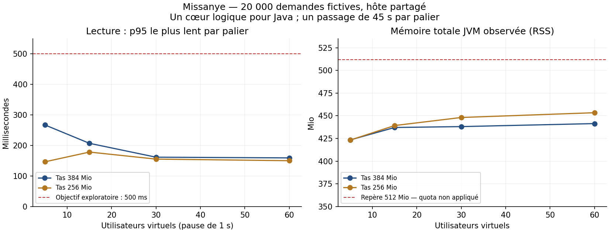

# Audit de performance Missanye — 18 novembre 2026

## Conclusion

Les parcours API testés ne montrent pas de saturation jusqu'à **60 utilisateurs virtuels**, y compris sur **100 000 demandes fictives**. Les neuf paliers sélectionnés totalisent **18 613 requêtes HTTP**, sans erreur HTTP et avec 100 % des contrôles de statut, de forme et d'appartenance à la paroisse réussis.

**Cela ne démontre pas la capacité de l'offre Render actuelle.** Le banc est local, le réseau vers PostgreSQL est court et Docker rootless n'applique pas ses quotas. Le test utilise une affinité CPU et un plafond de tas Java explicites, mais pas une limite de mémoire totale du processus. Les premières mesures basées sur les quotas Docker annoncés ont été écartées.

L'ordre recommandé est : **invalidation des caches par paroisse**, maîtrise du volume des statistiques, préparation multi-instance, puis mesure sur un staging aux ressources réellement garanties. Ajouter des instances uniquement pour accélérer ces parcours n'est pas justifié par les résultats locaux ; la haute disponibilité reste un objectif distinct.

## Banc et modèle de charge

- Backend inchangé du commit `7679ce701b2352f10ad4fc8c8afed2e36ac9d745`, JDK 17, profil `prod`, mêmes migrations Flyway, Hikari maximum 8 connexions et Tomcat maximum 40 threads.
- PostgreSQL 17.12 Alpine neuf ; dix paroisses fictives, vingt agents et 20 000 demandes initiales avec dates et factures. Un second volume ajoute 80 000 demandes. Les créations effectuées par le test s'ajoutent à ces volumes.
- Java lié au CPU logique 0 par `taskset`, `ActiveProcessorCount=1`, tas initial 128 Mio, tas maximal 384 puis 256 Mio. L'hôte partage un quota de deux CPU et 8 Gio entre application, base et générateur. Les limites Docker demandées de 1 CPU / 512 Mio pour l'app et 0,5 CPU / 512 Mio pour PostgreSQL **ne sont pas appliquées dans cet environnement**.
- Réseau Docker interne, sans port publié. Aucun accès à Render, Neon, SMTP ou fournisseur de paiement. Paiements et tâches métier périodiques désactivés ; créations avec le mode espèces, sans encaissement.
- Quatre paliers de 45 secondes par profil : 5, 15, 30, 60 VU ; une seconde de pause après chaque parcours. Préchauffage de 15 secondes, logins une fois au démarrage de chaque palier. Le volume 100 000 est testé au palier 60 VU, avec le tas de 256 Mio.
- Répartition déterministe : 40 % lecture des horaires publics, 35 % liste paginée + statistiques administratives, 20 % révision + delta desktop, 5 % dépôt de demande. Les listes utilisent principalement la première page et occasionnellement les pages 1 à 9.
- Rate limiting par IP désactivé dans les seuls paliers de capacité : les VU partagent l'IP du générateur. Vérification séparée avec les limites standard réactivées.

Les objectifs exploratoires sont p95 < 500 ms en lecture, p95 < 1 000 ms en création et moins de 1 % d'erreurs HTTP. **Le p95 signifie que 95 % des réponses observées sont plus rapides que ce temps ; il ne décrit pas le maximum.**

## Résultats

### Référence : tas maximal 384 Mio, 20 000 demandes

| VU | Débit HTTP global¹ | p95 lecture le plus lent² | p95 création | Erreurs HTTP | Pic RSS observé |
|---:|---:|---:|---:|---:|---:|
| 5 | 7,3 req/s | 267 ms | 290 ms | 0 % | 423 Mio |
| 15 | 21,1 req/s | 207 ms | 191 ms | 0 % | 437 Mio |
| 30 | 42,2 req/s | 162 ms | 141 ms | 0 % | 438 Mio |
| 60 | 83,4 req/s | 159 ms | 223 ms | 0 % | 441 Mio |

¹ Le débit global k6 inclut les logins de préparation ; les tendances par endpoint les excluent. Les requêtes de l'observateur de métriques ne figurent pas dans les compteurs k6.

² Maximum des p95 de chaque endpoint de lecture, pas percentile calculé sur leur mélange.

Les temps ne progressent pas de façon monotone : JIT et caches se réchauffent pendant la série. Ces mesures comportent un seul passage par palier, sans ordre aléatoire ni intervalle de confiance. Les petits écarts entre profils ne prouvent donc pas une amélioration causale.

### Vérifications complémentaires à 60 VU

| Volume initial | Tas maximal | p95 lecture le plus lent | p95 création | Pic RSS | Erreurs |
|---:|---:|---:|---:|---:|---:|
| 20 000 | 256 Mio | 150 ms | 192 ms | 453 Mio | 0 % |
| 100 000 | 256 Mio | 230 ms | 305 ms | 452 Mio | 0 % |

**Réduire le tas maximal de 384 à 256 Mio n'a pas réduit le RSS observé.** Le tas effectivement engagé reste voisin de 150 Mio dans les deux cas ; métadonnées de classes, code compilé, piles et autres allocations natives comptent aussi. Il ne faut pas appliquer une baisse du tas en production en espérant automatiquement récupérer 128 Mio.

À 60 VU, le temps CPU JVM observé représente environ 53 % d'un cœur dans la série 384 Mio, et 48 % dans la série 256 Mio, après exclusion des dix premières secondes d'échantillonnage. Des attentes Hikari transitoires sont observées : jusqu'à neuf dans un échantillon de la série 384 Mio, sans timeout HTTP. Ce relevé espacé de quelques secondes ne donne pas leur durée ni leur maximum réel ; il ne justifie pas d'augmenter arbitrairement le pool.

## Constats mesurés et priorités

### 1. Invalidation trop large des caches — priorité élevée

Les méthodes de mutation de `DemandeServiceImpl`, notamment `create`, portent `@CacheEvict(..., allEntries=true)`. Une création dans une paroisse efface les pages de demandes et les statistiques **de toutes les paroisses** sur cette instance.

Sur le palier 60 VU / 20 000 demandes / tas 384 Mio, les différences de compteurs Micrometer avant/après donnent :

| Cache | Hits | Misses | Taux de succès |
|---|---:|---:|---:|
| Horaires publics | 1 024 | 0 | 100 % |
| Détails d'authentification | 2 653 | 185 | 93,5 % |
| Statistiques paroissiales | 338 | 556 | 37,8 % |
| Pages de demandes | 235 | 659 | 26,3 % |

**Prochaine correction proposée :** invalider uniquement les clés de la paroisse concernée après validation de la transaction, ou versionner ces clés avec une révision partagée. Ajouter un test où une écriture dans A laisse le cache de B utilisable, et un test de rollback. Mesurer ensuite le même scénario avant/après ; aucun gain chiffré n'est promis sans cette comparaison.

### 2. Les statistiques chargent toutes les demandes impayées proches — priorité élevée à volume croissant

`buildParoisseStats` appelle `listUnpaidApproachingForParoisse`, puis enrichit et renvoie toute la liste. La requête correspondante est la première en temps SQL cumulé : **556 appels, 4,44 s cumulées, 7,99 ms en moyenne** au palier de référence 60 VU. À 100 000 demandes, elle atteint **512 appels, 15,64 s cumulées, 30,56 ms en moyenne**.

La base n'est pas en panne, mais ce coût et le volume de DTO augmentent avec les impayés de la fenêtre. Proposition : dissocier le comptage du widget d'une liste bornée/paginée, avec parcours dédié pour consulter le reste. Conserver les règles métier de dates et les droits.

### 3. Ne pas ajouter d'index redondant — priorité de contrôle, pas de déploiement

À 100 000 demandes, un SELECT représentatif de première page utilise déjà `idx_demande_paroisse_created_at` : **0,223 ms**, vingt lignes produites. La page avec offset 180 prend **0,631 ms**. Un delta vide utilise `desktop_demand_change_cursor` et prend **0,092 ms**.

Un index candidat partiel a été créé **uniquement dans une transaction de diagnostic locale puis annulé**. Le même SELECT a pris 0,144 ms, sur un seul passage après réchauffement des buffers : cet écart de 0,079 ms n'est pas une justification pour ajouter un index de production. Ces micro-requêtes n'incluent pas tous les joins ni les enrichissements JPA de l'endpoint.

### 4. La marge mémoire doit être validée sous un vrai quota

Un RSS observé de 441–453 Mio laisse peu de marge par rapport à 512 Mio, sans que le présent test impose réellement cette limite. Ce n'est ni une preuve d'OOM prochain, ni une garantie que 512 Mio suffisent. Avant dimensionnement : test prolongé sous quota réel, mesures GC et mémoire native, comparaison des paramètres JVM en conservant le même modèle de charge.

## Notifications et protections

- **SSE :** vingt connexions établies, une création réussie, exactement les deux clients de la paroisse modifiée notifiés, aucune erreur. La durée totale du probe est d'environ 27 secondes. Ce n'est pas un test de 128 flux ni de reconnexion derrière deux instances.
- **Rate limiting :** 60 lectures publiques autorisées puis la 61ᵉ bloquée ; huit connexions volontairement invalides renvoient 401 puis la neuvième renvoie 429. `Retry-After: 60` dans les deux cas.
- **Garde-fous :** cible externe, niveau supérieur à 100 et durée supérieure à 120 secondes rejetés à l'initialisation k6, avant tout scénario de charge.
- Aucun paiement réel, envoi SMTP, document utilisateur ni ligne de production n'a été utilisé.

## Avant de passer à deux instances sur Render

| Élément | État et action nécessaire |
|---|---|
| Authentification | JWT/cookies sans session serveur ; partager les mêmes secrets et paramètres entre instances. |
| Commandes desktop | UUID et confirmations durables ; garder les contrôles de versions et de paroisse. |
| Outbox e-mail | Prise de lots avec `SKIP LOCKED` et baux déjà adaptée à plusieurs workers ; clé de chiffrement identique requise. La livraison SMTP n'a pas été testée ici. |
| Révisions et journal | Compteurs partagés en PostgreSQL ; les événements peuvent être observés par chaque nœud. |
| Tâches planifiées | Ajouter des verrous distribués ou une exécution dédiée pour les rappels, annulations, balayages d'abonnement et rapprochements. Ne pas supposer que deux ordonnanceurs éviteront les doubles traitements. |
| Fichiers | `app.storage.root` est un stockage local ; prévoir un stockage d'objets partagé pour logos et dossiers. |
| Caches | Caffeine est local à chaque JVM ; un événement reçu sur A ne garantit pas l'invalidation du cache sur B. Prévoir révisions dans les clés ou invalidation distribuée. |
| Anti-abus | Les compteurs IP sont en mémoire locale ; deux instances multiplient la limite globale. Prévoir un contrôle partagé ou une passerelle. |
| PostgreSQL | Dimensionner le total des pools : huit par instance deviennent seize pour deux, auxquels s'ajoutent les autres clients. Vérifier la capacité réelle de la base avant changement. |
| SSE et bascule | Tester maintien/reconnexion des flux, déconnexion d'une instance et reprise des écritures avec mêmes UUID. |

Le load balancing ne doit donc pas être activé en production par simple duplication du service actuel. Un staging isolé avec données fictives et quotas effectifs doit ensuite vérifier latence réseau, endurance, pannes, fichiers, jobs et cohérence des caches. Aucun service cloud payant ni changement du nombre d'instances n'a été créé dans cet audit.

## Reproduire et consulter les données

- [Commandes et limites du banc](../../../performance/README.md)
- [Résultats structurés JSON](results-summary.json) et [table CSV](results-summary.csv)
- [Métadonnées de l'environnement](environment.json), [probe SSE](sse.json), [anti-abus](rate-limit.json), [garde-fous](guards.json)
- [Graphique SVG](capacity.svg)

Les sorties détaillées Prometheus, SQL et télémétrie restent dans `performance/results/` du workspace et sont ignorées par Git. Le banc est arrêté après les mesures. Aucun code fonctionnel du backend, du web ou du desktop n'est modifié par cette livraison documentaire.
